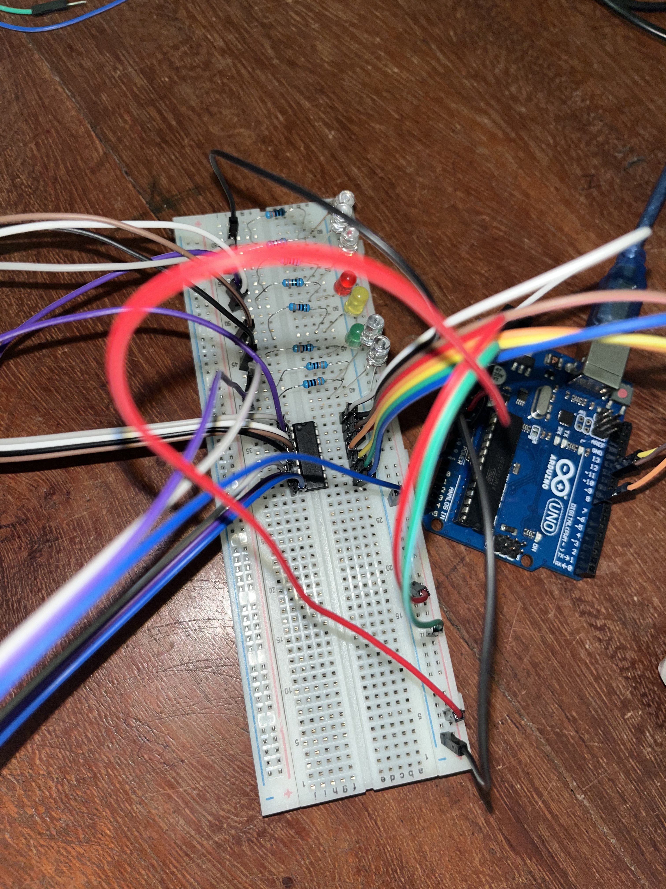

# 11 — 74HC595 Shift Register + LED Chase

Control 8 LEDs using only 3 Arduino pins through the SN74HC595N shift register. This project demonstrates output expansion — the core technique behind LED matrices, multiplexed displays, and any system that needs more outputs than the microcontroller provides.

## Components

| Component | Quantity | Role |
|-----------|----------|------|
| SN74HC595N shift register | 1 | Serial-in, parallel-out — converts 3 signals into 8 outputs |
| LEDs (mixed colors) | 8 | Visual output |
| 220 Ohm resistors | 8 | Current limiting for LEDs |
| Arduino UNO R3 | 1 | Microcontroller |

## How the 74HC595 Works

The 74HC595 is a **shift register** — it takes data in one bit at a time (serial) and outputs all 8 bits at once (parallel). Three signals control it:

- **DS (Data, pin 14)** — the bit value to shift in (0 or 1)
- **SHCP (Clock, pin 11)** — each pulse shifts one bit into the register
- **STCP (Latch, pin 12)** — a pulse transfers the shift register contents to the output pins

The sequence: set latch LOW → shift 8 bits in with `shiftOut()` → set latch HIGH → all 8 outputs update simultaneously.

```
        ┌────────────┐
   Q1 ──┤ 1       16 ├── VCC (5V)
   Q2 ──┤ 2       15 ├── Q0
   Q3 ──┤ 3       14 ├── DS (Data) ← Arduino pin 11
   Q4 ──┤ 4       13 ├── OE (→ GND)
   Q5 ──┤ 5       12 ├── STCP (Latch) ← Arduino pin 8
   Q6 ──┤ 6       11 ├── SHCP (Clock) ← Arduino pin 12
   Q7 ──┤ 7       10 ├── MR (→ 5V)
  GND ──┤ 8        9 ├── Q7' (cascade)
        └────────────┘
```

**Critical pins:**
- Pin 13 (OE) → **GND** — Output Enable, active LOW. If left floating, outputs won't work.
- Pin 10 (MR) → **5V** — Master Reset, active LOW. If left floating, register clears randomly.

## Circuit

```
Arduino pin 11 (data)  → 74HC595 pin 14 (DS)
Arduino pin 12 (clock) → 74HC595 pin 11 (SHCP)
Arduino pin 8  (latch) → 74HC595 pin 12 (STCP)

74HC595 pin 16 (VCC) → 5V
74HC595 pin 8  (GND) → GND
74HC595 pin 13 (OE)  → GND
74HC595 pin 10 (MR)  → 5V

74HC595 outputs Q0-Q7 (pins 15, 1-7) → 220Ω → LED anode → GND
```


## Code Highlights

- **`shiftOut(dataPin, clockPin, MSBFIRST, value)`** — sends 8 bits serially, most significant bit first
- **Latch framing** — `digitalWrite(latchPin, LOW)` before shifting, `HIGH` after, to update all outputs at once
- **Bit shift operator `<<`** — `1 << 5` produces `B00100000`, lighting only LED 5
- **Bitwise OR `|=`** — accumulates bits for the fill pattern
- **Bitwise AND + NOT `&= ~()`** — clears individual bits for the drain pattern
- **Binary literals** — `B11111111` is clearer than `255` when thinking in terms of 8 LED states

## Patterns

| Pattern | Logic | Visual |
|---------|-------|--------|
| Chase forward | `1 << (7-i)` | Single LED moves left to right |
| Chase reverse | `1 << i` | Single LED moves right to left |
| Fill | `valeur \|= (1 << i)` | LEDs turn on one by one |
| Drain | `valeur &= ~(1 << i)` | LEDs turn off one by one |
| Blink all | `B11111111` / `B00000000` | All LEDs flash together |

## Security Angle — Output Expansion in IoT

Shift registers are everywhere in IoT devices — behind LED matrices, segment displays, relay banks, and sensor arrays. From a security perspective:

- **Firmware analysis** — when reverse-engineering an IoT device, identifying shift register patterns in the firmware (serial clock + latch sequences) reveals how many outputs the device actually controls, even if they're not obvious from the PCB
- **Fault injection** — glitching the clock or latch pin on a shift register can cause outputs to fire in unintended states. On a relay bank controlling power or locks, that's a physical security issue
- **Cascading** — 74HC595s chain together (Q7' → next DS), so one compromised data line can control dozens of outputs

**Takeaway:** Understanding serial-to-parallel conversion helps you map the real attack surface of IoT hardware. The pins you see on the microcontroller are not the only outputs — shift registers multiply them silently.

## What I Learned

1. Three pins can control 8 (or more) outputs through serial-to-parallel conversion
2. The latch pin is the key — it holds outputs stable while new data shifts in
3. Bit manipulation (`<<`, `|=`, `&= ~()`) is the language of hardware control
4. Floating control pins (OE, MR) cause unpredictable behavior — always tie them
5. `shiftOut()` abstracts the clock+data dance, but understanding the underlying bit-by-bit transfer matters for debugging and security analysis

## Author

**Freemen Houngbedji** — Cybersecurity student · Building toward IoT security
