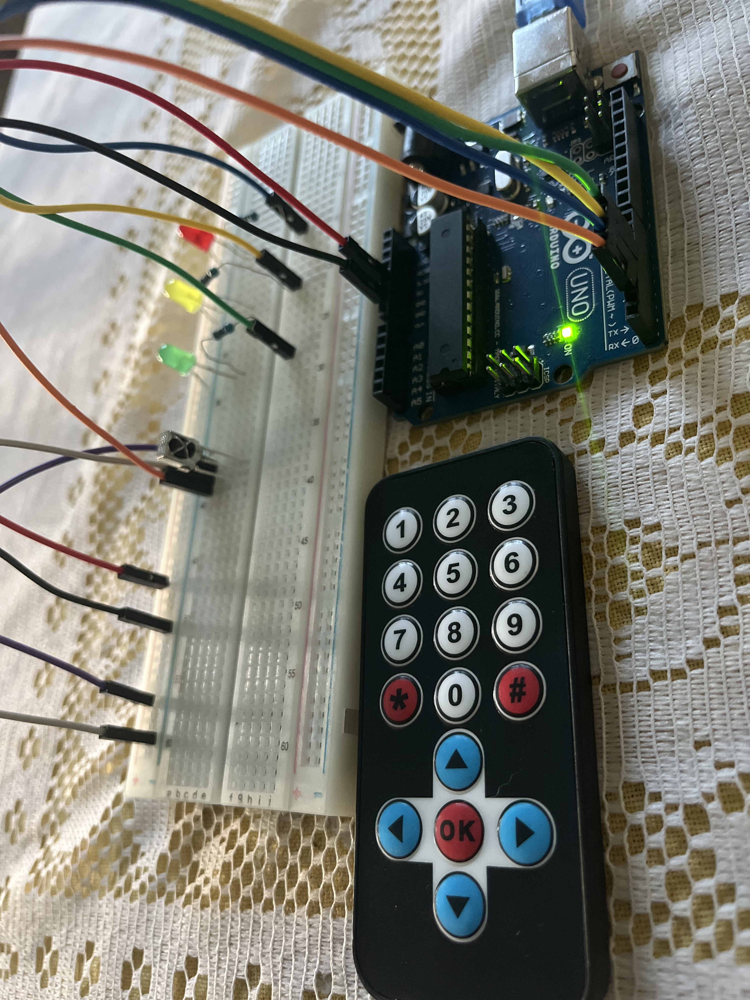

# 12 — IR Remote Control

Control LEDs with any infrared remote using the VS1838B IR receiver and the IRremote library. Decode NEC protocol signals, map buttons to actions, and toggle outputs with `switch/case`.

## Components

| Component | Quantity | Role |
|-----------|----------|------|
| VS1838B IR receiver | 1 | Receives 38kHz modulated IR signals |
| TV remote (any IR) | 1 | Transmitter — kit remote had no battery, a standard TV remote works |
| Red LED | 1 | Toggled by button 1 |
| Yellow LED | 1 | Toggled by button 2 |
| Green LED | 1 | Toggled by button 3 |
| 220 Ohm resistors | 3 | Current limiting for LEDs |
| Arduino UNO R3 | 1 | Microcontroller |

## Circuit

```
VS1838B (front view, dome facing you):
  Left pin  → Data → Arduino pin 2
  Middle    → GND
  Right pin → 5V

LEDs:
  Red    → pin 3 → 220Ω → GND
  Yellow → pin 4 → 220Ω → GND
  Green  → pin 5 → 220Ω → GND
```



## How IR Communication Works

The VS1838B receives infrared light modulated at **38kHz** — the carrier frequency filters out ambient light interference. The remote sends data using the **NEC protocol**:

1. **Leader pulse** — 9ms burst + 4.5ms space (marks start of transmission)
2. **32 data bits** — 8-bit address + 8-bit inverted address + 8-bit command + 8-bit inverted command
3. **Bit encoding** — a `1` is a 562.5µs burst + 1687.5µs space; a `0` is a 562.5µs burst + 562.5µs space

The inverted bytes serve as a **checksum** — the receiver verifies that `address + ~address = 0xFF` and `command + ~command = 0xFF`.

## Button Code Mapping

Decoded with `Serial.println(IrReceiver.decodedIRData.command, HEX)`:

| Button | HEX Code | Action |
|--------|----------|--------|
| 1 | 0x45 | Toggle red LED |
| 2 | 0x46 | Toggle yellow LED |
| 3 | 0x47 | Toggle green LED |
| OK | 0x1C | All LEDs OFF |
| 4 | 0x44 | — |
| 5 | 0x40 | — |
| 6 | 0x43 | — |
| 7 | 0x07 | — |
| 8 | 0x15 | — |
| 9 | 0x09 | — |
| 0 | 0x19 | — |
| * | 0x16 | — |
| # | 0x0D | — |
| Haut | 0x18 | — |
| Bas | 0x52 | — |
| Gauche | 0x08 | — |
| Droite | 0x5A | — |

> Any IR remote works with the VS1838B — the codes just differ per remote. Decode yours first, then map the buttons.

### Key Concepts

- **`IrReceiver.begin(pin)`** — initializes the IR receiver on a specific pin
- **`IrReceiver.decode()`** — returns `true` when a valid signal is received
- **`decodedIRData.command`** — the 8-bit command byte from the NEC frame
- **`IrReceiver.resume()`** — re-enables reception for the next signal (must call after every decode)
- **`switch/case`** — cleaner than chained `if/else` for mapping discrete values; each `case` needs a `break` or execution falls through
- **Toggle pattern** — `digitalWrite(pin, !digitalRead(pin))` reads the current state and writes the opposite

## Debugging Notes

- **Kit remote had no battery** — any TV or appliance IR remote works with the VS1838B since the receiver demodulates any 38kHz signal. Decode button codes first with Serial output, then map them.
- **`int code = (IrReceiver.decodedIRData.command, HEX)` bug** — `HEX` is a format flag for `Serial.println()`, not for variable assignment. The comma operator in C evaluates both sides but returns the right operand, so `code` would silently store `16` (the value of `HEX`). Fix: `int code = IrReceiver.decodedIRData.command;`
- **LEDs not toggling** — `digitalWrite(red, HIGH)` always sets HIGH, never toggles. The `!digitalRead()` pattern reads the pin's current state and inverts it.
- **Component confusion** — the kit's "IR flame sensor" label was misleading; the actual component was a VS1838B IR receiver module (3 pins: data, GND, VCC).

## Security Angle — IR Replay Attacks

IR signals have **zero authentication**. That means:

- **Replay attack** — capture an IR command with any receiver, replay it with an IR LED. The target device (TV, AC, projector) cannot tell the difference between the real remote and the replayed signal.
- **Flipper Zero** — a portable tool that can capture, store, and replay IR signals. One press to learn a remote, another to replay it on any compatible device.
- **No encryption, no rolling codes** — IR protocols like NEC send the same command byte every time. There is no session key, no challenge-response, no freshness check.

### IR vs RF — Why Cars Use Something Different

Vehicle key fobs use **RF (315/433 MHz)**, not IR, because RF passes through walls and works at distance. Modern key fobs use **rolling codes (KeeLoq)** — each press generates a new code from a synchronized PRNG seed shared between fob and car.

But rolling codes are not bulletproof:
- **RollJam attack** — an attacker jams the car's receiver while capturing the fob's signal. The owner presses again (second code captured, first replayed to unlock). The attacker now holds a valid unused code for later use.
- **Relay attack** — two devices extend the range between the key fob and the car, tricking the car into thinking the fob is nearby.

**Takeaway for IoT security:** Any wireless control system without mutual authentication is vulnerable. IR is the simplest example — no crypto, no handshake, pure replay. Understanding this at the hardware level is the foundation for securing IoT devices later.

## Real-World Applications

- **Home automation** — IR blasters (Broadlink, Tuya) centralize control of TVs, ACs, fans into one app or voice assistant
- **Universal remotes** — learn and replay IR codes from multiple devices
- **Industrial control** — IR communication in environments where RF interference is a concern
- **Accessibility** — IR-based interfaces for users with limited mobility

## What I Learned

1. IR communication is simple but completely insecure — no authentication layer exists in consumer IR protocols
2. The NEC protocol packs error detection (inverted bytes) but zero security
3. `switch/case` is the clean way to handle discrete command mapping in C
4. The `!digitalRead()` toggle pattern avoids needing state variables
5. Any IR remote works with any IR receiver — the protocol is universal, only the codes differ
6. The comma operator in C is a subtle trap — `(expression, HEX)` evaluates to `HEX`, not what you expect

## Author

**Freemen Houngbedji** — Cybersecurity student · Building toward IoT security
